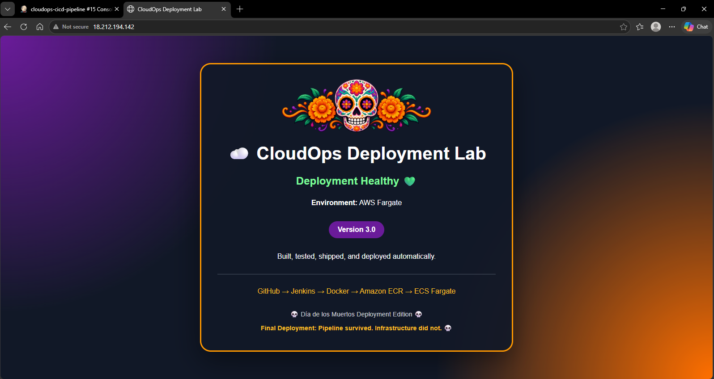
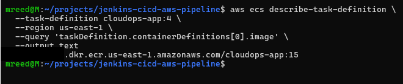
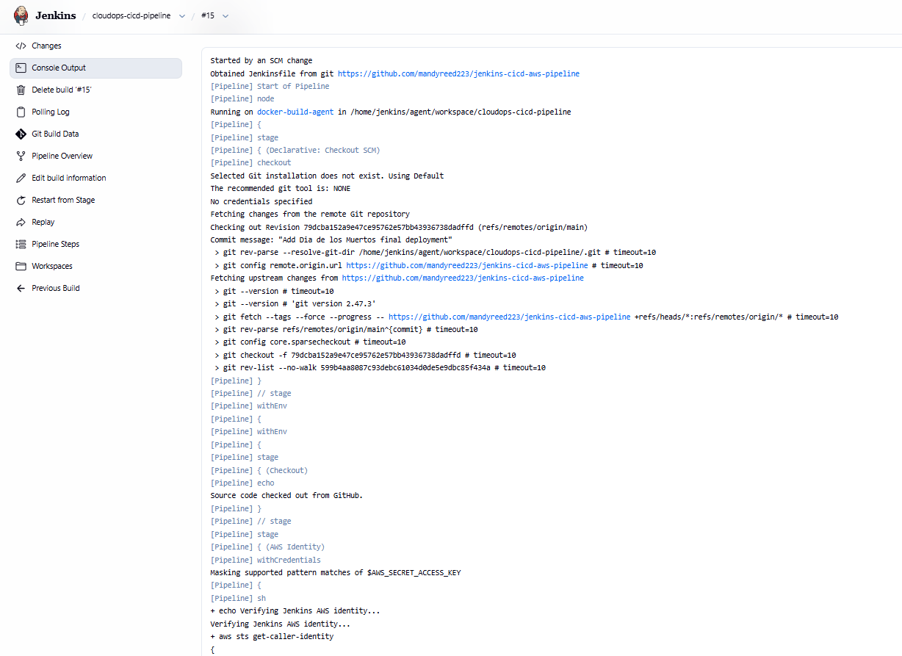
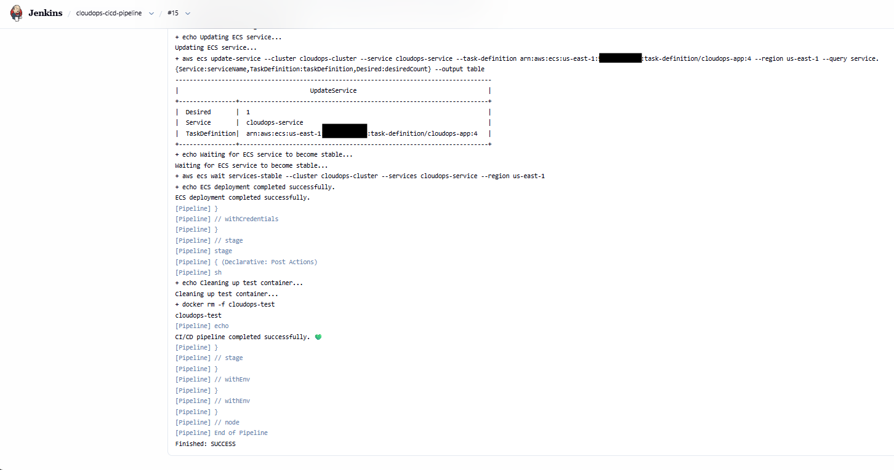
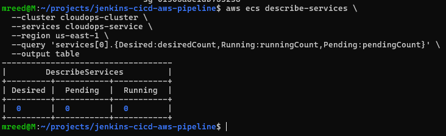
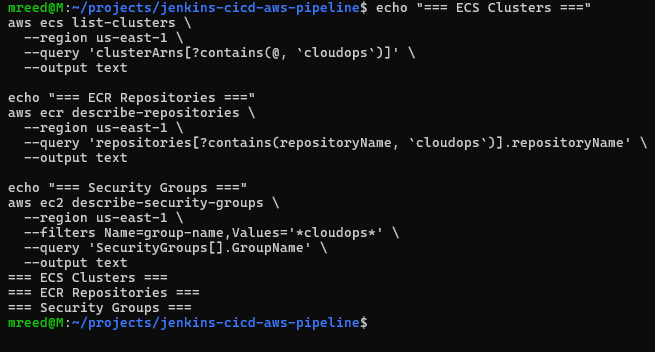
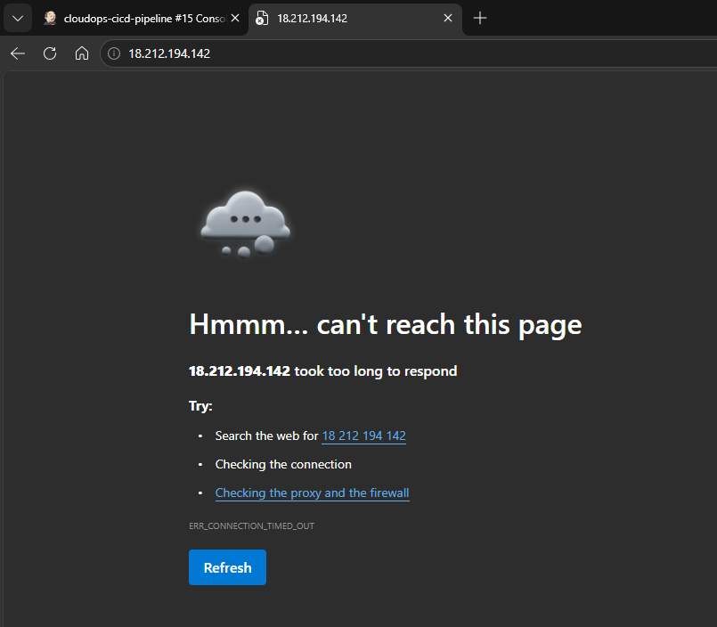
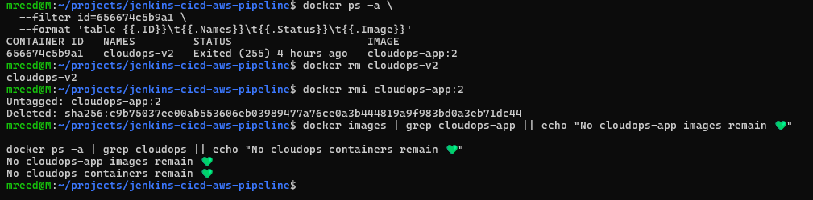
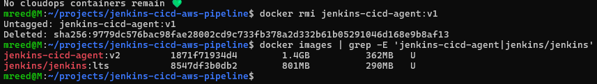
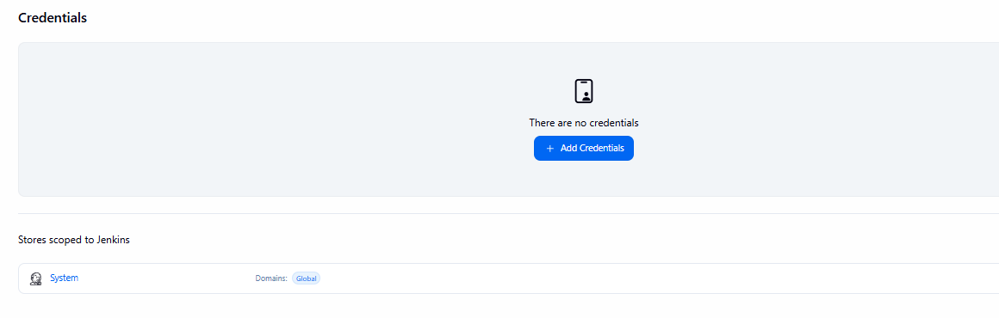

# 🚀 Jenkins CI/CD Pipeline to AWS ECS Fargate



A hands-on CI/CD project that builds, tests, packages, pushes, and deploys a containerized web application automatically using **GitHub, Jenkins, Docker, Amazon ECR, and Amazon ECS Fargate**.

This project started as a Jenkins pipeline exercise and evolved into a complete deployment lifecycle that included automated container builds, application health validation, ECR publishing, ECS task definition revisions, Fargate deployments, desired-state self-healing, intentional pipeline failure testing, recovery, and verified infrastructure cleanup.

The final pipeline:

```text
GitHub
   ↓
Jenkins
   ↓
Docker Build
   ↓
Application Quality Gate
   ↓
Amazon ECR
   ↓
ECS Task Definition
   ↓
ECS Service
   ↓
AWS Fargate
```

The application was intentionally broken, the pipeline correctly prevented the bad release from reaching production, ECS self-healing was tested by intentionally terminating a running task, and the complete AWS environment was removed and validated after the project.

---

## 🎯 Project Goals

The goal was to build a CI/CD workflow that could:

* Detect application changes from GitHub
* Automatically trigger Jenkins
* Build a Docker image
* Test the application before publishing it
* Prevent failed builds from continuing through the pipeline
* Authenticate Jenkins to AWS securely
* Push versioned container images to Amazon ECR
* Register new ECS task definition revisions automatically
* Update an ECS Fargate service
* Wait for the new deployment to stabilize
* Validate ECS desired-state recovery
* Prove that a bad application release would not reach production
* Clean up AWS and local Docker resources after testing

---

## 🏗️ Architecture

```text
Developer
    │
    │ git push
    ▼
GitHub Repository
    │
    │ SCM Polling
    ▼
Jenkins Controller
    │
    ▼
Jenkins Docker Build Agent
    │
    ├── Checkout Source
    │
    ├── Verify AWS Identity
    │
    ├── Build Docker Image
    │
    ├── Run Test Container
    │
    └── Execute Health Check
    │
    ▼
Amazon ECR
    │
    │ Versioned Docker Image
    ▼
ECS Task Definition
    │
    │ New Revision
    ▼
ECS Service
    │
    ▼
AWS Fargate Task
    │
    ▼
CloudOps Web Application
```

### Technology Stack

| Technology          | Purpose                      |
| ------------------- | ---------------------------- |
| GitHub              | Source control               |
| Jenkins             | CI/CD orchestration          |
| Docker              | Application packaging        |
| Nginx               | Web server                   |
| AWS CLI             | AWS automation from Jenkins  |
| Amazon ECR          | Container image registry     |
| Amazon ECS          | Container orchestration      |
| AWS Fargate         | Serverless container compute |
| IAM                 | ECS execution permissions    |
| EC2 Security Groups | Network access control       |
| Git                 | Version control              |

---

# 🧱 Phase 1: Build the Application

The application is a lightweight static web application served by Nginx.

The Dockerfile packages both the HTML application and its static assets:

```dockerfile
FROM nginx:alpine

COPY index.html /usr/share/nginx/html/index.html
COPY assets/ /usr/share/nginx/html/assets/

EXPOSE 80
```

The image was first built and tested locally before Jenkins was introduced.

```bash
docker build -t cloudops-app .
```

A local container could then be started and accessed through a mapped host port.

The important principle was simple:

> Jenkins should not be responsible for discovering whether the basic Docker application works.

The container was validated independently first, then automation was added.

---

# 🤖 Phase 2: Build a Jenkins Docker Agent

Rather than installing every required tool directly on the Jenkins controller, I created a reusable Jenkins build agent.

The custom agent included:

* Docker CLI
* AWS CLI v2
* Git
* curl
* unzip
* Access to the host Docker socket

The agent image was based on:

```dockerfile
FROM jenkins/inbound-agent:latest-jdk21
```

The working agent was ultimately versioned as:

```text
jenkins-cicd-agent:v2
```

This allowed Jenkins pipeline stages to execute Docker and AWS commands from an isolated build agent while preserving the Jenkins controller.

---

# 🔐 Phase 3: Authenticate Jenkins to AWS

AWS credentials were stored in the Jenkins credential store rather than committed to the repository.

The pipeline injected them only into stages that required AWS access.

The first AWS validation performed by Jenkins was:

```bash
aws sts get-caller-identity
```

This confirmed that the build agent could successfully authenticate before the pipeline attempted to interact with ECR or ECS.

No AWS access key or secret access key was stored in Git.

The Jenkins AWS credential was removed after the project was completed.

---

# 🐳 Phase 4: Build the Docker Image in Jenkins

Each Jenkins build used the Jenkins build number as the Docker image tag.

Conceptually:

```text
Jenkins Build #12
        ↓
cloudops-app:12

Jenkins Build #14
        ↓
cloudops-app:14

Jenkins Build #15
        ↓
cloudops-app:15
```

This created traceability between a Jenkins execution and the resulting container image.

Example:

```bash
docker build -t cloudops-app:${BUILD_NUMBER} .
```

Instead of repeatedly publishing a generic `latest` image, every successful build had its own identifiable artifact.

---

# 🧪 Phase 5: Add an Application Quality Gate

Building successfully does not prove that an application actually works.

The pipeline therefore started the newly built image as a temporary test container and queried the application from inside that container.

The validation looked for:

```text
Deployment Healthy
```

Conceptually:

```bash
wget -qO- http://localhost | grep "Deployment Healthy"
```

If `grep` finds the expected health text:

```text
exit code 0
        ↓
Test passed
        ↓
Continue pipeline
```

If the expected text is missing:

```text
exit code 1
        ↓
Test failed
        ↓
Pipeline stops
        ↓
No ECR push
        ↓
No ECS deployment
```

This became one of the most important controls in the project.

---

# 📦 Phase 6: Push Versioned Images to Amazon ECR

After the quality gate passed, Jenkins authenticated Docker to Amazon ECR.

The pipeline dynamically retrieved the AWS account ID and constructed the registry URI.

The locally built image was then tagged for ECR:

```text
cloudops-app:BUILD_NUMBER
        ↓
AWS_ACCOUNT_ID.dkr.ecr.us-east-1.amazonaws.com/cloudops-app:BUILD_NUMBER
```

The image was pushed only after the application test passed.

This ordering matters:

```text
Build
  ↓
Test
  ↓
PASS?
  ├── No → STOP
  │
  └── Yes
       ↓
      ECR
```

A broken application should never become a deployment artifact.

---

# ☁️ Phase 7: Deploy the Application to ECS Fargate

The ECS environment used:

* ECS cluster: `cloudops-cluster`
* ECS service: `cloudops-service`
* Task family: `cloudops-app`
* Launch type: AWS Fargate
* Container port: 80
* CPU: 256
* Memory: 512 MiB
* Network mode: `awsvpc`

The initial ECS task definition was bootstrapped using:

```text
aws/ecs/task-definition.json
```

The repository version uses placeholders for account-specific values:

```json
{
  "executionRoleArn": "arn:aws:iam::<AWS_ACCOUNT_ID>:role/cloudops-ecs-task-execution-role",
  "containerDefinitions": [
    {
      "name": "cloudops-app",
      "image": "<AWS_ACCOUNT_ID>.dkr.ecr.us-east-1.amazonaws.com/cloudops-app:<IMAGE_TAG>"
    }
  ]
}
```

This keeps the public repository reusable without publishing account-specific configuration.

---

# 🔗 Understanding the Deployment Linkage

One of the most important concepts in this project was understanding how the container built by Jenkins actually becomes the container running in ECS.

For the final deployment:

```text
Jenkins Build #15
        ↓
Docker creates cloudops-app:15
        ↓
Jenkins pushes cloudops-app:15 to ECR
        ↓
Jenkins reads the current ECS task definition
        ↓
containerDefinitions[0].image is changed to ECR image :15
        ↓
AWS registers task definition cloudops-app:4
        ↓
ECS service is updated to cloudops-app:4
        ↓
Fargate starts the container using image :15
```

The Jenkins build number and ECS task definition revision are independent values.

For example:

```text
Jenkins Build #14 → ECR Image :14 → ECS Task Definition :3
Jenkins Build #15 → ECR Image :15 → ECS Task Definition :4
```

The task definition revision does not need to match the Docker image tag.

The task definition simply contains a reference to the exact image ECS should run.

📸 **Deployment linkage validation**



This proves that ECS task definition revision `cloudops-app:4` referenced the container image produced by Jenkins Build #15.

---

# ⚙️ Phase 8: Automate ECS Deployment from Jenkins

The pipeline did not rely on a manually maintained task definition for every release.

Instead, Jenkins:

1. Retrieved the currently registered ECS task definition.
2. Changed the container image to the current Jenkins build.
3. Removed AWS-generated read-only fields.
4. Registered a new task definition revision.
5. Updated the ECS service.
6. Waited for ECS to report the service as stable.

The core flow was:

```text
Current Task Definition
        ↓
Read JSON
        ↓
Replace container image
        ↓
Register New Revision
        ↓
Update ECS Service
        ↓
Wait for Stable
```

This allowed a Git change to eventually result in a new running Fargate deployment without manually updating ECS.

---

# 💀 Phase 9: Test ECS Self-Healing

Once the application was healthy, I intentionally stopped the running ECS task.

At the time, the ECS service had:

```text
Desired = 1
Running = 1
```

After stopping the task:

```text
Desired = 1
Running = 0
```

ECS detected that the actual state no longer matched the desired state.

It automatically created a replacement task:

```text
Desired = 1
Pending = 1
Running = 0
```

Eventually:

```text
Desired = 1
Pending = 0
Running = 1
```

No manual recreation of the container was required.

This demonstrated the same desired-state principle used by container orchestration platforms such as Kubernetes:

```text
Desired State
      ↓
Compare
      ↓
Actual State
      ↓
Mismatch?
      ↓
Reconcile
```

The replacement Fargate task received a new public IP, and the application remained healthy.

---

# 🧨 Phase 10: Intentionally Break the Release

A successful pipeline is useful.

A pipeline that knows when **not** to deploy is more interesting.

I intentionally changed the application health text from:

```text
Deployment Healthy 💚
```

to:

```text
Deployment BROKEN 💀
```

The change was committed and pushed to GitHub.

Jenkins automatically detected the SCM change and started **Build #13**.

The Docker image itself built successfully.

But the application test failed.

The health check expected:

```text
Deployment Healthy
```

It received something else.

`grep` returned exit code `1`.

The result:

```text
Checkout         ✅
AWS Identity     ✅
Docker Build     ✅
Application Test ❌

ECR Push         SKIPPED
ECS Deploy       SKIPPED
```

This was exactly the behavior I wanted.

The pipeline prevented a known-bad application state from being published and deployed.

Even better, the existing production application remained healthy because Build #13 never reached the deployment stages.

---

# 🛡️ Why the Failed Build Matters

This test demonstrated an important CI/CD principle:

> A pipeline should protect production, not simply automate changes.

Without the quality gate:

```text
Bad Code
   ↓
Docker Build
   ↓
ECR
   ↓
ECS
   ↓
Broken Production
```

With the quality gate:

```text
Bad Code
   ↓
Docker Build
   ↓
TEST FAILS
   ↓
STOP 🛑

Production remains unchanged.
```

The failure was not a pipeline malfunction.

It was the pipeline doing its job.

---

# 🔧 Phase 11: Fix and Recover

The health text was restored:

```text
Deployment Healthy 💚
```

The fix was committed and pushed.

Jenkins automatically started the next build.

The pipeline:

* Checked out the corrected source
* Verified AWS authentication
* Built the Docker image
* Passed the application test
* Pushed the new image to ECR
* Registered a new ECS task definition
* Updated the ECS service
* Waited for the service to stabilize

The deployment recovered successfully.

---

# 🌼 Phase 12: Final Día de los Muertos Deployment

Because the final project deployment happened around Día de los Muertos, the application received one last visual update.

A sugar skull and marigold image was added as a static asset.

The Dockerfile was updated to package the new `assets/` directory:

```dockerfile
COPY assets/ /usr/share/nginx/html/assets/
```

Naturally, this produced one final troubleshooting opportunity.

The Docker build initially failed because the directory name had been mistyped.

```text
assets
```

had accidentally become:

```text
assests
```

Docker correctly reported that `/assets` could not be found in the build context.

Once the directory name was corrected, the image built successfully.

This was a small error, but a useful reminder:

> When Docker says a file or directory is missing from the build context, check the path before assuming Docker itself is broken.

The final change triggered **Jenkins Build #15**.

📸 **Jenkins automatically detects the final source change**



Build #15 completed the entire pipeline successfully.

📸 **Jenkins deploys the new ECS task definition and waits for stability**



The final production application was then validated on AWS Fargate.

📸 **Final Fargate deployment**


The final application displayed:

```text
Deployment Healthy 💚

GitHub → Jenkins → Docker → Amazon ECR → ECS Fargate

Final Deployment:
Pipeline survived. Infrastructure did not. 💀
```

That last line eventually became very literal.

---

# 🧹 Phase 13: Infrastructure Cleanup

The project did not end when the application successfully deployed.

The AWS environment was intentionally dismantled and verified.

Cleanup followed the resource dependencies rather than blindly deleting resources.

The ECS service was first scaled to zero:

```text
Desired = 0
Pending = 0
Running = 0
```

📸 **ECS desired state intentionally changed to zero**



This was an interesting contrast with the earlier self-healing test.

During self-healing:

```text
Desired = 1
Running = 0

ECS response:
Create another task.
```

During cleanup:

```text
Desired = 0
Running = 0

ECS response:
Everything matches.
```

The ECS service was then deleted and reached:

```text
INACTIVE
```

The ECS cluster was deleted and also verified as inactive.

The four task definition revisions created during the project were deregistered:

```text
cloudops-app:1
cloudops-app:2
cloudops-app:3
cloudops-app:4
```

All became:

```text
INACTIVE
```

The ECR repository and stored container images were deleted.

The project security group was deleted after confirming that no Fargate network interfaces still depended on it.

The ECS task execution policy was detached from the project IAM role, then the role was deleted.

AWS returned:

```text
NoSuchEntity
```

when the deleted role was queried.

Finally, I performed a resource sweep for remaining project resources.

📸 **Final AWS resource validation**



No matching ECS cluster, ECR repository, or project security group remained.

The pre-existing default VPC and default subnets were intentionally left untouched.

---

# 🪦 Final Validation: The Application Is Gone

After the infrastructure was removed, I refreshed the application's former public IP.

📸 **The former production endpoint after teardown**



The result:

```text
ERR_CONNECTION_TIMED_OUT
```

In most situations, that would be a problem.

Here, it was validation.

The application was unreachable because the infrastructure serving it no longer existed.

The final deployment had said:

```text
Pipeline survived.
Infrastructure did not. 💀
```

Mission accomplished.

---

# 🐳 Local Docker Cleanup

AWS cleanup was only part of the process.

The local environment had accumulated multiple application images during development:

```text
cloudops-app:1
cloudops-app:2
cloudops-app:10
cloudops-app:11
cloudops-app:12
cloudops-app:13
cloudops-app:14
cloudops-app:15
```

along with ECR-qualified image tags.

Those project-specific images were removed.

One image initially refused deletion because a stopped container still referenced it.

That demonstrated another dependency relationship:

```text
Stopped Container
       ↓
References Docker Image
       ↓
Image Cannot Be Removed
       ↓
Remove Container
       ↓
Remove Image
```

After removing the stopped container, the remaining CloudOps image could also be deleted.

Final validation returned:

```text
No cloudops-app images remain 💚
No cloudops containers remain 💚
```

📸 **Local CloudOps Docker cleanup complete**



---

# ♻️ What I Kept

Not everything was destroyed.

The Jenkins environment was intentionally designed to be reusable.

I kept:

```text
jenkins/jenkins:lts
jenkins-cicd-agent:v2
```

The obsolete `jenkins-cicd-agent:v1` image was removed.

📸 **Reusable Jenkins environment preserved**



This means future Jenkins projects can reuse the working controller and custom Docker/AWS build agent without rebuilding the entire CI environment.

---

# 🔐 Credential Cleanup

The AWS credential used by Jenkins was no longer necessary after the AWS infrastructure was destroyed.

The Jenkins copy of the AWS credential was therefore removed.

📸 **Jenkins credential store after cleanup**



The normal AWS CLI configuration was not removed.

This reduced unnecessary duplication of long-lived credentials while preserving the local AWS development environment.

---

# 🧠 Key Lessons

## 1. CI/CD is more than automatic deployment

The most valuable behavior in this pipeline was not that it could deploy successfully.

It was that it could refuse to deploy.

Build #13 proved that a failed application quality check stopped the pipeline before ECR and ECS.

---

## 2. Build artifacts should be traceable

Using Jenkins build numbers as Docker image tags created a direct relationship between pipeline execution and deployment artifact.

```text
Jenkins #15
    ↓
ECR :15
    ↓
Task Definition :4
    ↓
Fargate
```

---

## 3. ECS task revisions and image versions are different

An ECS task definition revision is not the Docker image version.

The task definition contains a reference to the image.

```text
Task Definition :4
        ↓
containerDefinitions[0].image
        ↓
ECR cloudops-app:15
```

Understanding that linkage made the automated deployment process much clearer.

---

## 4. Desired state drives self-healing

When the service desired one task and I killed the running task, ECS created another.

```text
Desired = 1
Actual = 0
      ↓
Mismatch
      ↓
ECS replaces task
```

Changing the desired count to zero during cleanup produced the opposite behavior.

---

## 5. A successful Docker build does not prove application health

Build #13 produced a valid Docker image.

The application inside that image still failed the expected health check.

Container build validation and application validation are different things.

---

## 6. Cleanup has dependencies too

AWS resources and Docker resources both demonstrated dependency ordering.

AWS:

```text
Fargate Task
    ↓
ECS Service
    ↓
ECS Cluster
    ↓
Task Definitions
    ↓
ECR
    ↓
Security Group
    ↓
IAM Role
```

Docker:

```text
Container
    ↓
Image
```

Understanding those relationships made cleanup controlled instead of destructive.

---

## 7. Verify cleanup instead of assuming it worked

The project ended with explicit checks confirming that the AWS resources, local application containers, local application images, and Jenkins AWS credential were gone.

Provisioning is only part of the resource lifecycle.

---

# 🔒 Security Notes

This was a hands-on lab environment rather than a production architecture.

For the lab:

* Fargate tasks received public IP addresses.
* Port 80 was exposed for direct application testing.
* HTTP was used instead of HTTPS.
* The default VPC and public subnets were used.
* Jenkins used an AWS credential stored in the Jenkins credential store.

For a production implementation, I would improve the architecture with:

* Private ECS tasks
* An Application Load Balancer
* HTTPS using AWS Certificate Manager
* Restricted security group relationships
* IAM roles or temporary credentials instead of long-lived AWS access keys
* Centralized logging and monitoring
* Automated vulnerability scanning
* Deployment strategies such as rolling, blue/green, or canary releases
* Secrets Manager or Parameter Store for application secrets

The public repository does not contain AWS secret access keys.

Account-specific values in the ECS bootstrap task definition were replaced with placeholders before final publication.

---

# 📁 Repository Structure

```text
jenkins-cicd-aws-pipeline/
│
├── .dockerignore
├── .gitignore
├── Dockerfile
├── Jenkinsfile
├── index.html
│
├── assets/
│   └── dia-de-los-muertos-header.png
│
├── aws/
│   ├── ecs/
│   │   └── task-definition.json
│   │
│   └── iam/
│       └── ecs-task-execution-trust-policy.json
│
├── jenkins/
│   └── agent/
│       └── Dockerfile
│
└── screenshots/
    ├── 11-jenkins-15-scm-trigger.png
    ├── 12-jenkins-15-ecs-deploy-success.png
    ├── 13-task-definition-4-image-15.png
    ├── 14-final-fargate-sugar-skull-deployment.png
    ├── 15-ecs-service-scaled-zero.png
    ├── 25-final-aws-sweep-clean.png
    ├── 28-app-unreachable-after-teardown.png
    ├── 31-local-cloudops-clean.png
    ├── 32-jenkins-v1-removed-v2-preserved.png
    └── 33-jenkins-credentials-removed.png
```

Additional screenshots documenting troubleshooting and cleanup are also retained in the `screenshots/` directory.

---

# 🔄 Pipeline Stages

The final Jenkins pipeline contained these primary stages:

```text
1. Checkout
      ↓
2. AWS Identity
      ↓
3. Build
      ↓
4. Test
      ↓
5. ECR Push
      ↓
6. ECS Deploy
      ↓
7. Post-Build Cleanup
```

A failure in an earlier stage prevents later deployment stages from running.

That behavior was intentionally tested rather than assumed.

---

# 🧪 Failure Testing Performed

This project intentionally tested multiple failure scenarios:

| Test                          | Expected Result              | Result   |
| ----------------------------- | ---------------------------- | -------- |
| Stop ECS task                 | ECS creates replacement      | ✅ Passed |
| Break application health text | Jenkins test fails           | ✅ Passed |
| Failed quality gate           | ECR push skipped             | ✅ Passed |
| Failed quality gate           | ECS deploy skipped           | ✅ Passed |
| Restore healthy application   | Pipeline succeeds            | ✅ Passed |
| Deploy new static asset       | New image deployed           | ✅ Passed |
| Scale ECS desired count to 0  | No replacement task          | ✅ Passed |
| Delete AWS infrastructure     | Endpoint becomes unavailable | ✅ Passed |
| Remove local images           | No CloudOps images remain    | ✅ Passed |
| Remove Jenkins AWS credential | Credential store clean       | ✅ Passed |

---

# 🏁 Final Result

The final successful deployment completed the full automated path:

```text
GitHub
   ↓
Jenkins Build #15
   ↓
Docker Image cloudops-app:15
   ↓
Application Quality Gate
   ↓
Amazon ECR cloudops-app:15
   ↓
ECS Task Definition cloudops-app:4
   ↓
ECS Service
   ↓
AWS Fargate
   ↓
Deployment Healthy 💚
```

The infrastructure was then intentionally destroyed and verified clean.

The Jenkins controller and reusable build agent survived for the next project.

The final application message turned out to be accurate:

> **Pipeline survived. Infrastructure did not. 💀**

---

## 💚 What This Project Demonstrates

This project demonstrates hands-on experience with:

**CI/CD • Jenkins • Docker • GitHub • AWS CLI • Amazon ECR • Amazon ECS • AWS Fargate • IAM • Container Networking • Application Health Checks • Deployment Automation • Desired-State Recovery • Failure Testing • Troubleshooting • Infrastructure Cleanup**

Most importantly, it demonstrates the workflow I enjoy most:

```text
Build it.
Understand it.
Break it.
Figure out why.
Fix it.
Prove it works.
Clean it up.
```

💚
